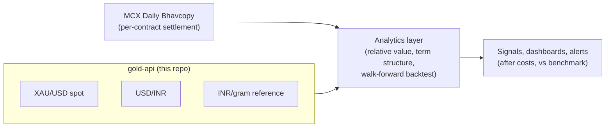

# Hackathon context — Hack in Hills '26, Track 03

This document explains where `gold-api` fits into the **Hack in Hills '26**
problem statement it was built around, and — just as importantly — what it
deliberately does *not* do.

> **Event:** Hack in Hills '26
> **Track:** 03 — Commodity Derivatives Intelligence
> **Theme:** India's public commodity futures data, specifically MCX gold
> contracts (GOLDM, GOLDTEN, GOLDGUINEA, GOLDPETAL).

## The track in one paragraph

MCX lists gold futures in several contract sizes that all reference the *same*
underlying metal. Their normalised prices should move together; the analysis is
about **measuring and responsibly explaining the differences** between them —
cross-contract relative value, term structure and carry, walk-forward
backtesting without look-ahead, and trader-facing intelligence that stays quiet
when there is no real signal. Crucially, performance must be reported *after
costs*, using the prices of the contracts actually held, and **strategy
performance must be separated from the movement of the gold price itself**.

## Where `gold-api` fits

The track's hardest methodological requirement is separating a *strategy's*
edge from movement in the *underlying*. That needs an independent, reproducible
reference for the underlying metal and for the currency it trades in.

`gold-api` is that **reference-data microservice**. It continuously publishes:

| Reference value | Endpoint | Why the track needs it |
|---|---|---|
| International gold spot, **XAU/USD** (per troy ounce and per gram) | `GET /api/v1/gold` | A neutral benchmark for the underlying, independent of any single MCX contract. |
| **USD/INR** reference FX | `GET /api/v1/fx` | MCX prices are INR-denominated; normalising to a common unit needs a documented FX series. |
| **Gold reference in INR/gram** | `GET /api/v1/gold` → `derived` | A single, auditable normalisation target (`XAU/USD ÷ 31.1034768 × USD/INR`). |
| Closed **daily bars** for XAU/USD | `GET /api/v1/bars` | Datable history for aligning the international benchmark to MCX trading days. |
| Provider **provenance + health** | `GET /api/v1/providers` | Every number carries a source, a timestamp and a staleness flag — required for defensible analysis. |

### Concepts it maps to directly

- **Normalise contract size, quotation base, and purity.** The service supplies
  the international both per-troy-ounce and per-gram figures and the USD/INR
  rate, so MCX contract quotes (per 10 g, per 8 g, per gram, etc.) can be
  expressed in one comparable unit.
- **Separate strategy performance from gold-price movement.** With a
  timestamped XAU/USD series alongside the MCX data, a relative-value signal can
  be reported against a benchmark rather than against raw gold drift.
- **Attribute performance to the strategy.** The `derived` block records the
  exact calculation and classification ("contextual reference; not an exchange
  settlement or executable price"), so results are reproducible and honest.

## What `gold-api` deliberately does **not** do

This is important for honest scoping:

- **It is not the MCX Bhavcopy ingester.** Track 03's primary dataset is the
  [MCX Daily Bhavcopy](https://www.mcxindia.com/market-data/bhavcopy) (Symbol,
  Date, ExpiryDate, OHLC, Volume, OpenInterest; no API key). That ingestion,
  contract-lifecycle tracking and cross-contract analytics live in the analysis
  application (see the companion `aurum-spread` project), not here.
- **It is not an executable feed.** Values are international *reference* data,
  explicitly not exchange settlements or fill prices.
- **It makes no trading claims.** It produces data, not signals.

Keeping these concerns separate is intentional: the reference layer stays small,
cacheable, and always-on, while the analytics layer can churn without touching
it.

## MCX contract mechanics (from the problem statement)

| Contract | Trading unit | Price quoted per | Purity | Expiry window |
|----------|--------------|------------------|--------|---------------|
| GOLDM | 100 g | 10 g | 995 | 3rd–5th |
| GOLDTEN | 10 g | 10 g | 999 | 27th–31st |
| GOLDGUINEA | 8 g | 8 g | 999 | 27th–31st |
| GOLDPETAL | 1 g | 1 g | 999 | 27th–31st |

### Data considerations the track flags (honoured downstream)

- Validate the returned `Date` against the requested date — MCX may return the
  most recent trading day for an unknown, holiday, malformed or future date.
- Requests use `DD/MM/YYYY`; responses use `MM/DD/YYYY`; `ExpiryDate` is compact
  (`04SEP2026`); `Symbol` may be space-padded.
- Track contracts by `expiry_date`, never a continuous near-month series.
- Settlement prices are official values, not automatically executable fills —
  especially for thin contracts. Volume ≠ depth.
- GOLDTEN only exists from its 2025 listing onward, so its history is shorter.

## How the pieces combine



`gold-api` is the always-on REF box. It is small on purpose so the analytics box
can iterate freely on top of a stable, well-documented reference.

## Judging-criteria alignment

| Track expectation | How this repo contributes |
|---|---|
| Normalise size/base/purity | Publishes the per-ounce, per-gram and INR/gram reference plus FX. |
| Defensible signal / analytical rigour | Every value timestamped and sourced; explicit "not executable" classification. |
| Separate strategy from gold price | Provides the independent XAU/USD benchmark for attribution. |
| Validate on unseen data | Datable daily bars enable point-in-time alignment for walk-forward replay. |
| Quiet when there is no signal | The reference layer is inherently passive; it emits no alerts and never fabricates movement. |

## Running it for the demo

```bash
# Local
uvicorn app.main:app --port 8000
curl -s localhost:8000/api/v1/gold | jq '.derived.gold_reference_inr_per_gram'

# Deployed (Railway)
curl -s "$GOLD_API_URL/api/v1/snapshot" | jq '.mode'
```

See the [README](README.md) for full deployment and API details.

## Attribution

Free commercial use of the goldprice.dev keyless tier requires visible
attribution. Any hackathon demo or write-up that displays this data must credit:

> Gold spot data provided by [goldprice.dev](https://goldprice.dev). FX by
> [Frankfurter](https://frankfurter.dev).
