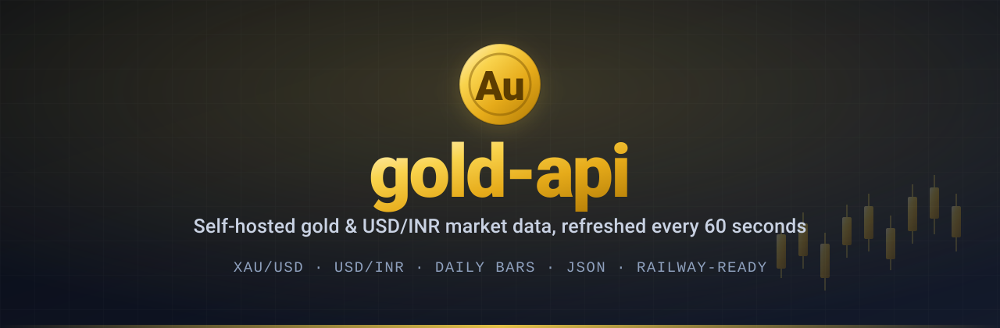
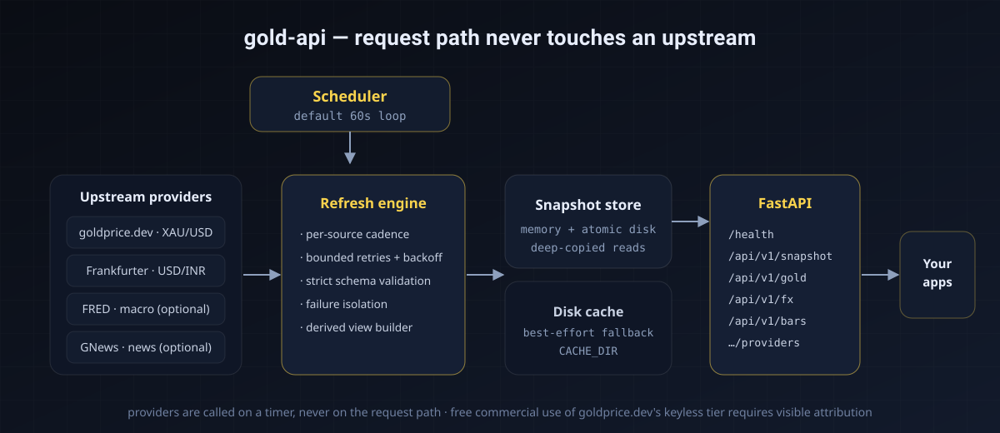

<div align="center">



**A small, self-hosted market-data API for gold and USD/INR.**

Pulls gold spot, reference FX, daily bars and optional macro/news context on a
60-second schedule, assembles one snapshot, and serves it as plain JSON that any
downstream service can consume.

[](https://github.com/sru-codes/gold-api/actions/workflows/ci.yml)
[](LICENSE)
[](https://www.python.org/)
[](https://fastapi.tiangolo.com/)
[](tests)
[](https://railway.app/)
[](CONTRIBUTING.md)
[](https://github.com/sru-codes/gold-api/releases)

<p>
  <a href="#6-installation">Installation</a> ·
  <a href="#10-api-reference">API reference</a> ·
  <a href="#11-consuming-the-api-how-to-use-it">Usage</a> ·
  <a href="#13-deployment">Deployment</a> ·
  <a href="HACKATHON.md">Hackathon</a>
</p>

</div>

---

## Table of contents

1. [What is this?](#1-what-is-this)
2. [Why use it](#2-why-use-it)
3. [Features](#3-features)
4. [How it works (architecture)](#4-how-it-works-architecture)
5. [Requirements](#5-requirements)
6. [Installation](#6-installation)
7. [Project structure](#7-project-structure)
8. [Configuration](#8-configuration)
9. [Running the service](#9-running-the-service)
10. [API reference](#10-api-reference)
11. [Consuming the API (how to use it)](#11-consuming-the-api-how-to-use-it)
12. [Data sources & methodology](#12-data-sources--methodology)
13. [Deployment](#13-deployment)
14. [Development](#14-development)
15. [Testing](#15-testing)
16. [Operations](#16-operations)
17. [Troubleshooting & FAQ](#17-troubleshooting--faq)
18. [Roadmap](#18-roadmap)
19. [Contributing](#19-contributing)
20. [Security](#20-security)
21. [License](#21-license)
22. [Attribution](#22-attribution)

---

## 1. What is this?

`gold-api` is a **single-process HTTP service** that keeps a small set of
gold- and currency-related market data fresh, and exposes it as clean JSON.

It does three things, in a loop, forever:

1. **Fetches** gold spot (XAU/USD), USD/INR reference FX, daily gold bars, and
   optionally macro and news data from public upstream providers.
2. **Assembles** everything into one timestamped "snapshot", plus a few derived
   values such as gold priced in INR per gram.
3. **Serves** that snapshot over a read-only JSON API that your own applications
   can call.

The important design property: **upstream providers are never called while a
client is waiting.** Data is fetched on a background timer and served from
memory. Your users get fast, predictable responses; you get control over load.

It requires **no API keys** to work, **no database**, and **no message broker** —
just one container and a place to persist a couple of small files.

> Looking for the hackathon framing? See [HACKATHON.md](HACKATHON.md).

---

## 2. Why use it

Several widely-used gold APIs require paid keys, impose aggressive rate limits,
or return a single opaque number. `gold-api` is built to be the opposite:

| | Typical hosted gold API | `gold-api` |
|---|---|---|
| Hosting | Their servers | **Yours** |
| Credentials | Usually required | **Keyless by default** |
| Load model | You hit them per request | **Timer-driven; requests never touch upstreams** |
| Provenance | Often opaque | **Source URL + timestamp + staleness on every value** |
| Failure mode | Whole API errors | **Per-section degrade; the rest keeps serving** |
| Cost | Subscription | **Free (respect the providers' terms)** |

---

## 3. Features

- **60-second refresh loop** — fast-moving spot data refreshes every cycle;
  slower sources run on their own cadence and feed the same snapshot.
- **Read-only, versioned JSON API** — `/api/v1/...` endpoints plus interactive
  OpenAPI docs at `/docs`.
- **Degraded-mode reporting** — a failing upstream degrades one section and sets
  the overall `mode` to `PARTIAL` or `DEGRADED`. It never takes the service down.
- **Provider health endpoint** — status, last update, auth requirement and known
  limitations for every upstream.
- **Best-effort disk cache** — upstream responses are cached so a transient
  outage reuses a recent observation. A read-only or missing volume can never
  break collection.
- **Snapshot persistence** — the assembled snapshot is written to disk and
  reloaded on boot, so a restart does not start empty.
- **Optional write protection** — a bearer token can protect the manual refresh
  endpoint while all read endpoints stay public.
- **Zero-database** — one process, a few files, no migrations.
- **Hermetic tests** — the data layer is standard-library only and tested
  offline with an injected fake transport.

---

## 4. How it works (architecture)

<div align="center">
  
</div>

**Request lifecycle**

1. On boot, the app starts a background scheduler and performs a full first
   cycle immediately.
2. Each cycle, the engine asks each source whether its own interval has elapsed.
   If so, it calls the provider through a retrying, caching HTTP client,
   validates the payload against a strict schema, and swaps the section into the
   in-memory store.
3. A client request only reads that in-memory store and computes the derived
   view. **No request path performs network I/O.**
4. The whole snapshot is persisted to disk after each cycle and reloaded on the
   next boot.

---

## 5. Requirements

| Need | Version / note |
|---|---|
| Python (running from source) | **3.12** recommended (3.11+ works) |
| Docker (container path) | any recent Docker Engine |
| OS | Linux/macOS/Windows — nothing platform-specific |
| Outbound network | HTTPS to the configured providers |
| Disk (optional) | a writable directory for the cache and snapshot |
| Database / broker | **none** |

Runtime Python dependencies are only **FastAPI** and **uvicorn**. The data layer
(`app/providers`, the engine) uses the standard library exclusively.

---

## 6. Installation

### Option A — Run from source (recommended for development)

```bash
# 1. Get the code
git clone https://github.com/sru-codes/gold-api.git
cd gold-api

# 2. Create and activate a virtual environment
python3 -m venv .venv
source .venv/bin/activate        # Windows: .venv\Scripts\activate

# 3. Install runtime dependencies
pip install -r requirements.txt

# 4. (optional) copy the example config — every default works without it
cp .env.example .env

# 5. Run
uvicorn app.main:app --reload --port 8000
```

Open <http://localhost:8000/docs> for the interactive API.

### Option B — Run with Docker

```bash
git clone https://github.com/sru-codes/gold-api.git
cd gold-api

docker build -t gold-api .

docker run --rm -p 8000:8000 \
  -v gold-api-data:/data \
  -e ADMIN_TOKEN="$(openssl rand -hex 32)" \
  gold-api
```

The image is `python:3.12-slim` + FastAPI/uvicorn. It listens on `$PORT`
(default `8000`).

### Option C — Deploy to Railway

See [Deployment → Railway](#railway-recommended). In short: point Railway at the
repo, attach a volume at `/data`, set a domain, done.

### Option D — No install (one-shot check)

If you only want to confirm the upstreams work from your machine:

```bash
python3 -m venv .venv && . .venv/bin/activate
pip install -r requirements.txt
python scripts/smoke_test.py
```

This performs a single forced refresh and prints a summary — no server started.

---

## 7. Project structure

```
gold-api/
├── app/                       # The application package
│   ├── __init__.py            # Package version
│   ├── config.py              # Settings read from environment, with defaults
│   ├── store.py               # Thread-safe snapshot store + disk persistence
│   ├── refresh.py             # Scheduling engine + derived view builder
│   ├── main.py                # FastAPI app: routes, lifespan scheduler, CORS
│   └── providers/             # One module per upstream data source
│       ├── __init__.py        # Public adapter exports
│       ├── base.py            # JSON HTTP client: retries, backoff, disk cache
│       ├── goldprice.py       # goldprice.dev: XAU/USD spot + daily bars
│       ├── frankfurter.py     # Frankfurter: USD/INR reference FX
│       ├── fred.py            # Optional FRED macro observations
│       └── gnews.py           # Optional GNews headlines
│
├── assets/                    # README artwork (self-contained SVG)
│   ├── banner.svg             # Hero banner at the top of this README
│   ├── logo.svg               # Square gold "Au" coin logo
│   └── architecture.svg       # System diagram used in section 4
│
├── scripts/
│   ├── client_example.py      # Minimal consumer example (how to call the API)
│   └── smoke_test.py          # Offline one-shot refresh, prints a summary
│
├── docs/
│   └── postman_collection.json  # Import into Postman/Insomnia to call every endpoint
│
├── tests/                     # Hermetic unit tests (no network)
│   ├── conftest.py            # Makes `app` importable for tests
│   ├── test_math.py           # Troy-ounce → INR/gram conversion
│   ├── test_store.py          # Store isolation, error retention, persistence
│   ├── test_scheduling.py     # First-cycle + interval scheduling rules
│   └── test_provider_parsing.py  # Strict schema validation (fake transport)
│
├── .github/
│   ├── workflows/ci.yml       # Lint + test job, Docker build job
│   ├── ISSUE_TEMPLATE/        # Bug / feature templates, contact links
│   ├── PULL_REQUEST_TEMPLATE.md
│   └── dependabot.yml         # Weekly pip / docker / actions updates
│
├── Dockerfile                 # Container image (no VOLUME — Railway rejects it)
├── railway.json               # Railway build + deploy (healthcheck at /health)
├── Makefile                   # make install / run / test / lint / smoke / docker-*
├── requirements.txt           # Runtime deps (fastapi, uvicorn)
├── requirements-dev.txt       # Dev deps (pytest, ruff)
├── pyproject.toml             # pytest + ruff configuration
├── .editorconfig              # Editor defaults (indent, EOL, trailing space)
├── .env.example               # Every environment variable, with defaults
├── .dockerignore              # Keeps the image small (excludes tests/docs/.venv)
├── .gitignore                 # Ignores .venv, caches, data, .env
├── README.md                  # You are here
├── HACKATHON.md               # How this fits Hack in Hills '26 Track 03
├── CHANGELOG.md               # Release history (Keep a Changelog)
├── CONTRIBUTING.md            # How to contribute
├── SECURITY.md                # Vulnerability reporting + hardening
├── CODE_OF_CONDUCT.md         # Contributor Covenant 2.1
└── LICENSE                    # MIT
```

**What each core file does**

- `app/config.py` — turns environment variables into one immutable `Settings`
  object. Every value is optional and has a safe default.
- `app/store.py` — the in-memory source of truth. Writes and reads are mutex
  guarded; reads return deep copies so callers cannot corrupt state. Also
  persists/loads the snapshot atomically.
- `app/refresh.py` — the brain. Decides what is due, calls the right provider,
  records per-provider health, and builds the derived view.
- `app/main.py` — the HTTP surface. Defines routes, enables CORS, starts the
  background scheduler on startup and stops it on shutdown.
- `app/providers/base.py` — a small JSON-over-HTTP client with bounded retries,
  exponential backoff, `Retry-After` support and a transparent disk cache.

---

## 8. Configuration

Every variable is optional. Copy `.env.example` to `.env` for local runs. On
Railway/Docker, set them as environment variables.

### Scheduling

| Variable | Default | Meaning |
|---|---|---|
| `REFRESH_INTERVAL_SECONDS` | `60` | How often the master loop wakes up. |
| `GOLD_INTERVAL_SECONDS` | `60` | How often to refresh gold spot. |
| `FX_INTERVAL_SECONDS` | `300` | How often to refresh USD/INR. |
| `BARS_INTERVAL_SECONDS` | `3600` | How often to refresh daily bars. |
| `MACRO_INTERVAL_SECONDS` | `3600` | How often to refresh FRED data. |
| `NEWS_INTERVAL_SECONDS` | `900` | How often to refresh news. |

Each source only refreshes when its own interval has elapsed. The **first** cycle
always fetches everything.

### History windows

| Variable | Default | Meaning |
|---|---|---|
| `BARS_HISTORY_DAYS` | `30` | Days of daily bars to request. |
| `MACRO_HISTORY_DAYS` | `90` | Days of FRED history to request. |

### Credentials (all optional)

| Variable | Default | Meaning |
|---|---|---|
| `GOLDPRICE_API_KEY` | *(empty)* | Higher limits / fresher gold spot. |
| `FRED_API_KEY` | *(empty)* | Enables the `macro` section. |
| `GNEWS_API_KEY` | *(empty)* | Enables the `news` section. |

### Context selectors

| Variable | Default | Meaning |
|---|---|---|
| `FRED_SERIES` | `DGS10` | Comma-separated FRED series ids. |
| `GNEWS_QUERY` | `gold price` | Search query. |
| `GNEWS_MAX_ARTICLES` | `10` | 1–10 (free-tier cap). |

### Storage

| Variable | Default | Meaning |
|---|---|---|
| `DATA_DIR` | `/data` | Root for persisted state. |
| `CACHE_DIR` | `/data/cache` | Provider response cache. |

### Service & security

| Variable | Default | Meaning |
|---|---|---|
| `ADMIN_TOKEN` | *(empty)* | Bearer token protecting `POST /api/v1/refresh`. Empty = open. |
| `CORS_ORIGINS` | `*` | Comma-separated allowed origins. |
| `SERVICE_NAME` | `gold-api` | Reported in metadata. |
| `ENGINE_VERSION` | `1.0.0` | Reported in metadata. |
| `LOG_LEVEL` | `INFO` | Python logging level. |
| `PORT` | `8000` | Injected by Railway; forwarded to uvicorn. |

Example `.env`:

```dotenv
REFRESH_INTERVAL_SECONDS=60
GOLD_INTERVAL_SECONDS=60
FX_INTERVAL_SECONDS=300
DATA_DIR=./data
CACHE_DIR=./data/cache
ADMIN_TOKEN=change-me
CORS_ORIGINS=https://my-frontend.example.com
```

---

## 9. Running the service

### Development (auto-reload)

```bash
uvicorn app.main:app --reload --port 8000
```

### Production-style (local)

```bash
uvicorn app.main:app --host 0.0.0.0 --port 8000 --proxy-headers
```

### Check it is alive

```bash
curl -s localhost:8000/health
```

`status` is `"starting"` until the first cycle finishes, then `"ok"`.

### First-run timing

The first cycle fetches every source (a few seconds). Until a section has data,
its endpoint returns `503`. This is expected and disappears within one cycle.

---

## 10. API reference

Base URL below is `http://localhost:8000`. All responses are JSON. Interactive
docs: `GET /docs`; machine schema: `GET /openapi.json`.

### `GET /`

Service metadata and an endpoint index.

```json
{
  "service": "gold-api",
  "engine_version": "1.0.0",
  "schema_version": "1",
  "refresh_interval_seconds": 60,
  "endpoints": {
    "snapshot": "/api/v1/snapshot",
    "gold": "/api/v1/gold",
    "fx": "/api/v1/fx",
    "bars": "/api/v1/bars",
    "macro": "/api/v1/macro",
    "news": "/api/v1/news",
    "providers": "/api/v1/providers",
    "health": "/health",
    "refresh": "POST /api/v1/refresh",
    "docs": "/docs"
  }
}
```

### `GET /health`

Liveness/readiness. Used as the Railway healthcheck.

| Field | Type | Meaning |
|---|---|---|
| `status` | string | `starting` or `ok`. |
| `sections_ready` | string[] | Sections that have produced data. |
| `last_cycle_at_utc` | string\|null | Time the last full cycle finished. |
| `cycle_count` | int | Completed cycles since boot. |

### `GET /api/v1/snapshot`

The complete payload — everything in one response.

```jsonc
{
  "schema_version": "1",
  "engine_version": "1.0.0",
  "service": "gold-api",
  "generated_at_utc": "2026-10-15T06:17:45.251316Z",
  "mode": "LIVE",                      // LIVE | PARTIAL | DEGRADED
  "refresh_interval_seconds": 60,
  "sections": {
    "gold":  { "data": {}, "status": "ok", "source_url": "…", "fetched_at_utc": "…" },
    "fx":    { "data": {}, "status": "ok" },
    "bars":  { "data": {}, "status": "ok" },
    "macro": { "data": {}, "status": "ok" },
    "news":  { "data": {}, "status": "ok" }
  },
  "derived": { "gold_reference_inr_per_gram": {} },
  "providers": [ { "id": "goldprice.dev", "status": "available" } ],
  "meta": { "started_at_utc": "…", "last_cycle_at_utc": "…", "cycle_count": 3 }
}
```

Every section has the shape:

| Field | Type | Meaning |
|---|---|---|
| `data` | object\|null | The section payload (null if never fetched). |
| `status` | string | `ok` or `error`. |
| `error` | object\|null | `{ code, message }` when `status` is `error`. |
| `source_url` | string\|null | The upstream URL used. |
| `fetched_at_utc` | string\|null | When the data was fetched. |

### `GET /api/v1/gold`

Gold spot plus the derived INR view.

| Field | Meaning |
|---|---|
| `gold.data.price_usd_per_troy_ounce` | Spot price per troy ounce, USD. |
| `gold.data.price_usd_per_gram` | Spot price per gram, USD. |
| `gold.data.computed_at_utc` | Upstream computation time. |
| `gold.data.is_stale` | Upstream staleness flag. |
| `gold.data.sources` | Per-source breakdown returned by the provider. |
| `derived.gold_reference_inr_per_gram.value` | Gold in INR per gram. |
| `derived.gold_reference_inr_per_gram.calculation` | The exact formula used. |
| `derived.gold_reference_inr_per_gram.classification` | "contextual reference; not executable". |

### `GET /api/v1/fx`

USD/INR reference rate.

| Field | Meaning |
|---|---|
| `data.base` / `data.quote` | Currency pair (`USD` / `INR`). |
| `data.rate` | Reference rate. |
| `data.requested_date` | The date requested. |
| `data.effective_date` | The date the rate actually applies to (never after the request). |

### `GET /api/v1/bars`

Closed daily bars over the configured window.

| Field | Meaning |
|---|---|
| `data.symbol` | `XAU-USD-SPOT`. |
| `data.interval` | `1d`. |
| `data.from` / `data.to` | Requested window. |
| `data.count` | Number of closed bars returned. |
| `data.bars[]` | `bar_start_utc`, `open/high/low/close_usd_per_troy_ounce`, `is_closed`. |

### `GET /api/v1/macro`

Optional FRED series. When `FRED_API_KEY` is unset, returns
`{"status": "ok", "data": {"note": "FRED_API_KEY not configured", …}}`.

### `GET /api/v1/news`

Optional GNews headlines. Same behaviour when unconfigured.

### `GET /api/v1/providers`

Per-provider health, auth requirement, coverage and known limitations.

### `POST /api/v1/refresh`

Forces an immediate refresh of every source.

- If `ADMIN_TOKEN` is **empty**, the endpoint is open.
- If set, send `Authorization: Bearer <token>`; otherwise you get `401`.

```bash
curl -X POST http://localhost:8000/api/v1/refresh \
  -H "Authorization: Bearer $ADMIN_TOKEN"
```

### Errors

| Status | Meaning |
|---|---|
| `503` | The requested section has not produced data yet: `{"detail": "section 'bars' is not ready yet"}`. |
| `401` | Refresh requested without/with a wrong bearer token. |
| `422` | Malformed request (FastAPI validation). |

---

## 11. Consuming the API (how to use it)

Point any HTTP client at the base URL. CORS is enabled by default, so browsers
can call it directly.

### Python (standard library only)

```python
import json
import os
import urllib.request

BASE = os.getenv("GOLD_API_URL", "https://your-service.up.railway.app")

with urllib.request.urlopen(f"{BASE}/api/v1/gold", timeout=10) as response:
    payload = json.load(response)

spot = payload["gold"]["data"]["price_usd_per_troy_ounce"]
inr_per_gram = payload["derived"]["gold_reference_inr_per_gram"]["value"]
print(f"XAU/USD {spot} | INR/g {inr_per_gram}")
```

A runnable version lives in [`scripts/client_example.py`](scripts/client_example.py):

```bash
GOLD_API_URL=http://localhost:8000 python scripts/client_example.py
```

### JavaScript / TypeScript

```js
const base = process.env.GOLD_API_URL ?? "http://localhost:8000";
const res = await fetch(`${base}/api/v1/snapshot`);
if (!res.ok) throw new Error(`gold-api ${res.status}`);
const { mode, sections, derived } = await res.json();

console.log(mode);                                        // "LIVE"
console.log(sections.gold.data.price_usd_per_troy_ounce); // "4150.89"
console.log(derived.gold_reference_inr_per_gram.value);   // "12687.49…"
```

### curl

```bash
BASE=http://localhost:8000

curl -s "$BASE/health" | jq
curl -s "$BASE/api/v1/gold"  | jq '.gold.data.price_usd_per_troy_ounce'
curl -s "$BASE/api/v1/fx"    | jq '.data.rate'
curl -s "$BASE/api/v1/bars"  | jq '.data.count'
curl -s "$BASE/api/v1/providers" | jq '.providers[].status'
curl -s "$BASE/api/v1/snapshot"  | jq '.mode'
```

### Postman / Insomnia

Import [`docs/postman_collection.json`](docs/postman_collection.json) — it contains
every endpoint, with `baseUrl` and `adminToken` collection variables. Change
`baseUrl` to your deployment and you are done.

### Reading it safely

- Always check `mode` before assuming full data: `PARTIAL`/`DEGRADED` means at
  least one section is stale or erroring.
- Prefer `sections.<name>.fetched_at_utc` for freshness decisions rather than
  assuming the data is "now".
- Values that matter are returned as **strings** (to preserve decimal precision);
  parse them as decimals, not floats, in your language of choice.

---

## 12. Data sources & methodology

| Section | Upstream | Auth | Default cadence |
|---|---|---|---|
| `gold` | goldprice.dev `XAU-USD-SPOT` | optional key | 60 s |
| `fx` | Frankfurter USD/INR | none | 300 s |
| `bars` | goldprice.dev daily bars | optional key | 3600 s |
| `macro` | FRED | `FRED_API_KEY` | 3600 s |
| `news` | GNews | `GNEWS_API_KEY` | 900 s |
| `derived` | computed in-process | — | every snapshot |

**Derived value**

```
gold_reference_inr_per_gram = (XAU/USD per troy ounce ÷ 31.1034768) × (USD/INR)
```

- `31.1034768` is the exact number of grams in a troy ounce.
- The formula and both inputs are returned alongside the value.
- It is explicitly **a contextual reference** — not an exchange settlement, not
  a GST-inclusive retail price, and not an executable quote.

---

## 13. Deployment

### Railway (recommended)

1. **Create the project.** Railway → *New Project* → *Deploy from GitHub repo* →
   `sru-codes/gold-api`.
2. **Build.** Railway detects the root `Dockerfile` automatically and builds it.
3. **Attach a volume.** Add a Railway **Volume mounted at `/data`**.
   > The `Dockerfile` intentionally declares **no** `VOLUME` directive — Railway
   > rejects Dockerfile `VOLUME` with *"docker VOLUME … not supported, use
   > Railway Volumes"*. Attach a Railway Volume instead.
4. **Set variables** (all optional) in the service's *Variables* tab:

   | Variable | Purpose |
   |---|---|
   | `ADMIN_TOKEN` | Protect `POST /api/v1/refresh`. Generate with `openssl rand -hex 32`. |
   | `GOLDPRICE_API_KEY` | Higher limits / fresher spot. |
   | `FRED_API_KEY` | Enables `macro`. |
   | `GNEWS_API_KEY` | Enables `news`. |
   | `CORS_ORIGINS` | e.g. `https://your-app.up.railway.app`. |

5. **Expose a domain.** Settings → *Networking* → *Generate Domain*.
6. **Verify.**

   ```bash
   curl -s https://<your-domain>/health
   curl -s https://<your-domain>/api/v1/snapshot | jq .mode
   ```

Railway injects `PORT`; the container forwards it to uvicorn. The healthcheck is
`GET /health` (configured in `railway.json`).

### Docker (anywhere)

```bash
docker build -t gold-api .
docker run --rm -p 8000:8000 \
  -v gold-api-data:/data \
  -e ADMIN_TOKEN="$(openssl rand -hex 32)" \
  gold-api
```

### Other platforms (Fly.io, Render, a VPS)

Anywhere that can build a Dockerfile works. Ensure:

- the container port matches the platform's expectation (the app honours `PORT`);
- a persistent volume is mounted at `/data` (optional but recommended);
- outbound HTTPS is allowed.

---

## 14. Development

```bash
python3 -m venv .venv && . .venv/bin/activate
pip install -r requirements.txt -r requirements-dev.txt

ruff check .        # lint
pytest              # tests
```

Run live with auto-reload:

```bash
uvicorn app.main:app --reload
```

### Shortcuts with `make`

If you have `make`, the [Makefile](Makefile) wraps the common tasks:

```bash
make help          # list every target
make install       # create .venv and install runtime + dev deps
make run           # uvicorn with auto-reload on :8000
make test          # pytest
make lint          # ruff check .
make fmt           # ruff check . --fix
make smoke         # one-shot offline refresh (no server)
make docker-build  # docker build -t gold-api .
```

### Adding a provider

1. Create `app/providers/<name>.py` with a strict schema validator that raises
   `ProviderError` on any unexpected shape.
2. Wire it into `RefreshEngine` with its own interval and a
   `store.put_provider(...)` health record.
3. Add a unit test using an injected fake transport for both a valid and an
   invalid payload.
4. Document it in the README data-sources table.

See [CONTRIBUTING.md](CONTRIBUTING.md) for the full workflow.

---

## 15. Testing

Tests are **hermetic** — no network. Provider tests inject a fake transport, so
they run offline and deterministically.

```bash
pytest -q
```

Current coverage (26 tests):

| File | What it covers |
|---|---|
| `test_math.py` | Troy-ounce → INR/gram conversion, including guards. |
| `test_store.py` | Read isolation, error retention, persistence round-trips. |
| `test_scheduling.py` | First-cycle regression, interval rules, orchestration order. |
| `test_provider_parsing.py` | Valid + invalid payload handling for every provider. |

---

## 16. Operations

- **Refresh cadence.** The master loop runs every `REFRESH_INTERVAL_SECONDS`
  (60 s). A source is fetched only if its own interval has elapsed; the first
  cycle always fetches all sources.
- **Caching.** Upstream responses are cached under `CACHE_DIR`, honoured via a
  TTL, and used as a fallback on transient failure. Cache reads/writes are
  best-effort: a read-only or missing directory degrades caching, not service.
- **Persistence.** The snapshot is written atomically to
  `DATA_DIR/published/snapshot.v1.json` and reloaded on boot.
- **Failure isolation.** A provider error is recorded per section; everything
  else keeps serving and `mode` becomes `PARTIAL`/`DEGRADED`.
- **Logging.** Structured lines from the `gold_api` and `gold_api.refresh`
  loggers; verbosity via `LOG_LEVEL`.
- **Scaling.** One instance is enough. If you run several, each keeps its own
  snapshot — there is no shared coordination by design (avoid it unless needed).

---

## 17. Troubleshooting & FAQ

| Symptom | Likely cause | Fix |
|---|---|---|
| `/health` stays `starting` | First cycle still running, or all providers failing | Check logs; confirm outbound network to the providers. |
| `503 section 'x' is not ready` | That source has not completed its first fetch | Wait one cycle, or `POST /api/v1/refresh`. |
| `mode` is `PARTIAL` | One or more sections are in `error` | Inspect `/api/v1/providers` for the failing id. |
| `goldprice.dev` → `rate_limited` | Keyless tier limit hit | Set `GOLDPRICE_API_KEY` or raise `GOLD_INTERVAL_SECONDS`. |
| `/data` not writable | Volume missing/mis-mounted | Mount a volume at **exactly** `/data`. |
| Railway: `docker VOLUME … not supported` | A `VOLUME` directive in the Dockerfile | This repo omits it — do not re-add `VOLUME`. |
| `POST /api/v1/refresh` → `401` | `ADMIN_TOKEN` is set | Send `Authorization: Bearer <token>`. |
| Everything works but `macro`/`news` are empty | Keys not configured | Set `FRED_API_KEY` / `GNEWS_API_KEY`, or ignore (context only). |

**FAQ**

- **Do I need any API key?** No. The service runs keyless. Keys only raise limits
  or enable the optional `macro`/`news` sections.
- **Is this an executable price feed?** No. Values are reference data for
  analysis, explicitly not exchange settlements or fill prices.
- **Do you store history?** Only the cache and the latest snapshot on disk. For
  history, poll `/api/v1/snapshot` and store it yourself, or use
  `/api/v1/bars`.
- **Can I change the refresh rate?** Yes — set `REFRESH_INTERVAL_SECONDS` and the
  per-source intervals.
- **Does it need a database?** No.

---

## 18. Roadmap

- [ ] Optional symbol list (silver, platinum) behind one provider.
- [ ] Prometheus-style `/metrics` endpoint.
- [ ] Historical FX alignment utilities for backtesting consumers.
- [ ] Pluggable provider registry driven by configuration.

---

## 19. Contributing

Contributions are welcome. Please read [CONTRIBUTING.md](CONTRIBUTING.md) and the
[Code of Conduct](CODE_OF_CONDUCT.md) first. Keep the data layer
dependency-free and add hermetic tests for new providers.

---

## 20. Security

Do **not** open public issues for security problems. See [SECURITY.md](SECURITY.md)
for private reporting and the deployment hardening checklist.

---

## 21. License

Released under the [MIT License](LICENSE).

---

## 22. Attribution

Free commercial use of the goldprice.dev keyless tier requires visible
attribution. If you deploy this service, keep the following somewhere your users
can see it (e.g. an "About" or "Data sources" page):

> Gold spot data provided by [goldprice.dev](https://goldprice.dev).

FX data is provided by [Frankfurter](https://frankfurter.dev). Optional macro
data is provided by [FRED](https://fred.stlouisfed.org). Optional headlines are
provided by [GNews](https://gnews.io).
